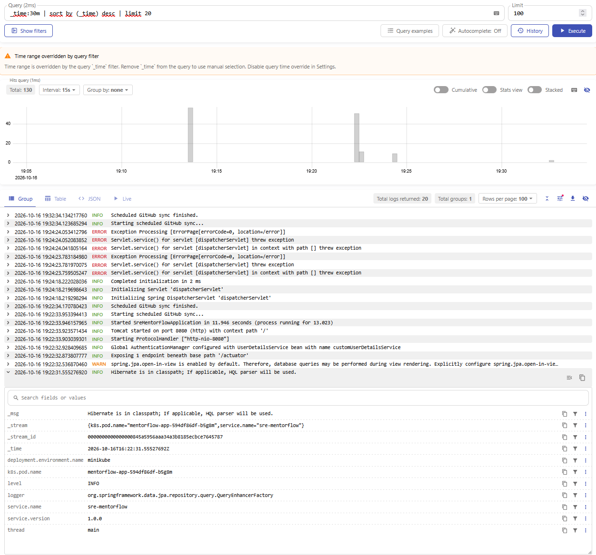
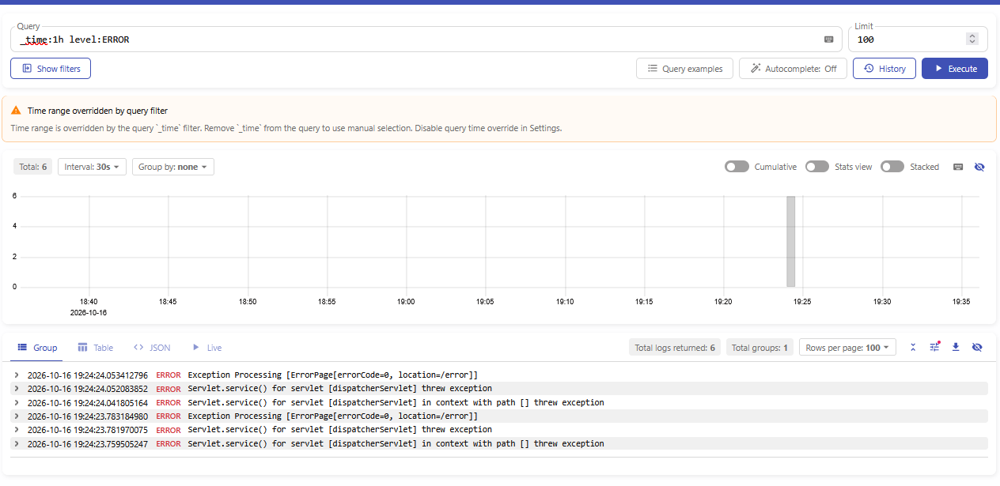
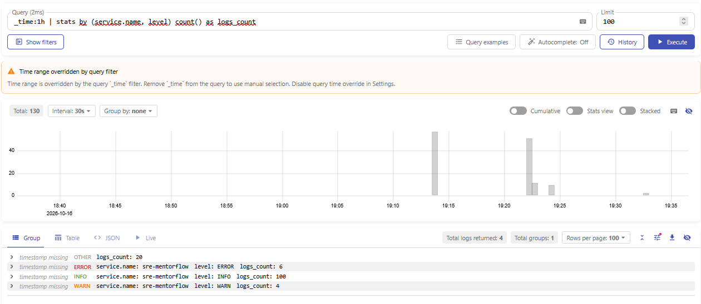
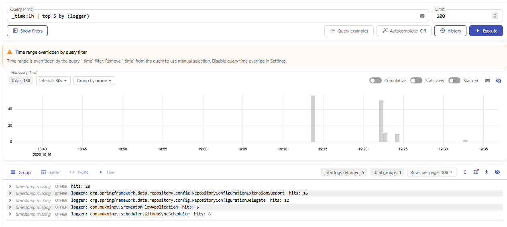
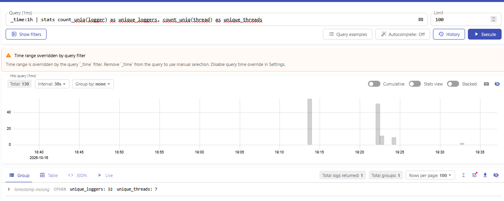
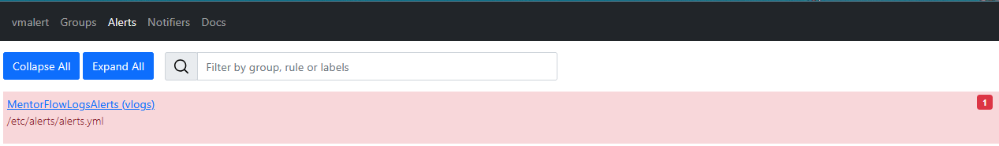

# Отчёт по домашнему заданию №2: Victoria Logs и централизованный сбор логов в Kubernetes

## 1. Архитектура решения и оркестрация через Kustomize

В кластере `minikube`, где работает приложение `sre-mentorflow` из ДЗ №1, развёрнут стек сбора, хранения и алертинга по логам:
1. **Изоляция в отдельном Namespace (`logging`)**: все компоненты наблюдаемости (`Victoria Logs`, `Vector`, `vmalert`) вынесены в собственное пространство имён `logging`.
2. **Декларативное управление конфигами без хардкода (`kustomization.yaml`)**: конфигурация агента `k8s/vector.toml` и правила алертинга `k8s/alerts.yml` вынесены в отдельные файлы и автоматически упаковываются в версионированные `ConfigMap` через `configMapGenerator` при выполнении команды `kubectl apply -k k8s/`
3. **Использование `StatefulSet` + `PVC`**: база данных `Victoria Logs` развёрнута как `StatefulSet` с `volumeClaimTemplates` (`1Gi`) для сохранности колоночных блоков (`parts`) при рестартах пода.
4. **Probes, Resources и Tolerations**: для всех новых компонентов настроены `requests`/`limits` по CPU и памяти, HTTP-пробы (`readinessProbe`, `livenessProbe` на `/health`), а для `DaemonSet` агента Vector добавлены `tolerations` для работы на узлах с `Taints`.

---

## 2. Настройка JSON-логирования в приложении (`sre-mentorflow`)

С помощью `logstash-logback-encoder` и конфигурации `src/main/resources/logback-spring.xml` логирование приложения переведено в структурированный формат JSON в `stdout`. В соответствии с чек-листом семинара и конвенциями OpenTelemetry каждая запись содержит поля:
* `timestamp` — время события в формате ISO 8601 (UTC)
* `level` — уровень важности (`INFO`, `WARN`, `ERROR`)
* `message` — текст сообщения
* `service.name` (`sre-mentorflow`), `service.version` (`1.0.0`), `deployment.environment.name` (`minikube`)
* `k8s.pod.name` — имя конкретного пода-реплики в Kubernetes
* `logger`, `thread` и `error.stack` (стектрейс исключения при ошибках)

---

## 3. Обоснование выбора способа доставки логов (Vector в режиме DaemonSet)

Для доставки логов из подов приложения в Victoria Logs выбран агент **Vector** (`timberio/vector:0.39.0-alpine`), развёрнутый как **`DaemonSet`** (`k8s/vector.yml` + `k8s/vector.toml`).

**Почему выбран именно этот способ:**
1. **Соблюдение 11-го фактора Twelve-Factor App:** приложение пишет поток событий в `stdout` и не зависит от доступности лог-хранилища.
2. **Высокая производительность и малый расход ресурсов:** Vector написан на Rust, не требует JVM и потребляет минимум CPU и RAM на ноде.
3. **Распаковка CRI/Docker-обёртки через VRL:** контейнерный рантайм в Kubernetes оборачивает строки `stdout` в технический формат CRI/Docker. С помощью VRL-трансформации (`remap`) Vector извлекает чистый JSON приложения перед отправкой.

**Нативный маппинг полей Victoria Logs:** отправка выполняется по протоколу Elasticsearch Bulk API (`/insert/elasticsearch/`) с параметрами `_msg_field = "message"`, `_time_field = "timestamp"` и `_stream_fields = "service.name,k8s.pod.name"`, `_level_field = "level"`, что обеспечивает группировку потоков и физическую локальность данных на диске

---

## 4. Выполненные LogsQL-запросы в `vmui`

Доступ к веб-интерфейсу `vmui` осуществлялся через проброс порта:
`kubectl port-forward svc/victoria-logs-service -n logging 9428:9428` (`http://localhost:9428/select/vmui/`).

### (а) Сырые записи за последние N минут
**Запрос:**
```
_time:30m | sort by (_time) desc | limit 20
```

**Что показывает запрос:**

Выбирает сырые лог-записи приложения за последние 30 минут, сортирует их по времени события от новых к старым и выводит последние 20 записей со всеми распарсенными полями (`_time`, `_msg`, `_stream`, `level`, `logger`, `thread`).

### (б) Фильтр по конкретному полю

**Запрос:**

```
_time:1h level:ERROR
```



**Что показывает запрос:**

Фильтрует записи за последний час строго по полю `level:ERROR`. Позволяет мгновенно находить ошибки выполнения и анализировать стектрейс в поле `error.stack`.

### (в) Stats-запрос с группировкой

**Запрос:**

```
_time:1h | stats by (service.name, level) count() as logs_count
```



**Что показывает запрос:**

Выполняет статистическую агрегацию за последний час с группировкой по имени сервиса (`service.name`) и уровню важности (`level`), подсчитывая количество логов каждого типа (`INFO`, `WARN`, `ERROR`).

### (г) Агрегирующий запрос (`top` и `count_uniq`)

**Запрос 1 (Топ-5 самых активных классов-логгеров):**

```
_time:1h | top 5 by (logger)
```



**Запрос 2 (Подсчёт уникальных логгеров и потоков через `count_uniq`):**

```
_time:1h | stats count_uniq(logger) as unique_loggers, count_uniq(thread) as unique_threads
```



**Что показывает запрос:**

- Запрос с `top 5 by (logger)` возвращает 5 Java-классов приложения, сгенерировавших наибольшее число записей за последний час.

- Запрос с `count_uniq` считает количество уникальных классов-логгеров (`logger`) и уникальных потоков JVM (`thread`), которые писали логи за выбранный интервал.

## 5. Бонусное задание: Алертинг через `vmalert`

В неймспейсе `logging` развёрнут компонент **`vmalert`** (`k8s/vmalert.yml`), проверяющий каждые 15 секунд правило `MentorFlowHighErrorRate` (`k8s/alerts.yml`) по запросу:

```
_time:5m level:ERROR | stats count() as error_count | filter error_count:>0
```



При появлении записей с `level:ERROR` за последние 5 минут алерт переходит в статус **`FIRING`** в веб-интерфейсе `vmalert` (`http://localhost:8880/vmalert/alerts`).
